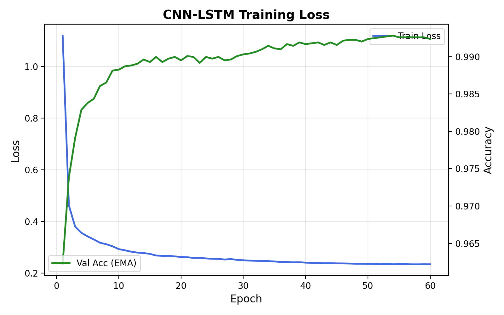

# ECG Arrhythmia Detection

A full-stack web application that classifies ECG heartbeats into the five AAMI arrhythmia classes with a deep
**CNN + BiLSTM + Attention** network trained on the MIT-BIH Arrhythmia Database.
Upload a single heartbeat or a batch of beats, or analyze a random beat from the MIT-BIH test set, and get
per-beat predictions, confidence scores and model-attention visualisations.

**Repository:** https://github.com/nikhilkumar905/ECG-Arrhythmia-Detection

**Live demo:** https://ecg-arrhythmia-detection-weld.vercel.app/

**Model weights (Hugging Face):** https://huggingface.co/nikhilkumar905/ECG-Arrhythmia-Detection

[](https://huggingface.co/nikhilkumar905/ECG-Arrhythmia-Detection)


## Contents

- [Classes](#classes)
- [Features](#features)
- [How it works](#how-it-works)
- [Using the app](#using-the-app)
- [Model](#model)
- [Training](#training)
- [Results](#results)
- [Pretrained weights on Hugging Face](#pretrained-weights-on-hugging-face)
- [Tech stack](#tech-stack)
- [Project structure](#project-structure)
- [Getting started](#getting-started)
- [Input format](#input-format)
- [API](#api)
- [Configuration](#configuration)
- [Deployment](#deployment)
- [Retraining the model](#retraining-the-model)
- [Limitations](#limitations)
- [Acknowledgements](#acknowledgements)
- [License](#license)

## Classes

| Code | Class | Description |
|---|---|---|
| N | Normal | Normal beat, including bundle branch block and nodal escape beats |
| S | Supraventricular | Premature beat originating above the ventricles (atria or AV node) |
| V | Ventricular | Premature ventricular contraction (PVC) |
| F | Fusion | Fusion of a ventricular and a normal beat |
| Q | Unknown | Unclassifiable or paced beat |

## Features

- **Upload and analyze**: a single heartbeat or a batch of up to 5,000 beats (CSV / TXT / NPY, 187 samples per row)
- **Random MIT-BIH beat**: load a random heartbeat from the held-out test set, optionally of a chosen class,
  preview its waveform and analyze it; the true class is revealed only after the prediction
- **Per-beat results**: predicted class, confidence ring and probabilities for all five classes
- **Model attention**: shades the parts of each beat the attention layer focused on
- **Needs-review flag**: marks beats with low confidence (< 70%) or two close top classes (margin < 20%)
- **Batch view**: class distribution, a filterable list of all beats (all / abnormal / needs review / mismatches)
  and ← / → keyboard navigation
- **Accuracy vs. labels**: accuracy and a clickable confusion matrix whenever true labels are provided
- **Model performance page**: test-set accuracy, F1, per-class precision / recall / specificity, confusion matrix
  and training figures
- **CSV export** of all predictions; responsive layout with dark and light themes

| Single beat | Model performance |
|---|---|
|  |  |

## How it works

```
Heartbeats (187 values each)            React app (Vercel)
from an uploaded file or a      ──►     sends the file / sample name
random MIT-BIH test beat                          │
                                                  ▼
                                        FastAPI backend (Render)
                                        1. parse rows of 187 values (+ optional label)
                                        2. standardise with the training scaler
                                        3. CNN-BiLSTM-Attention → class probabilities
                                        4. attention weights, review flag, batch summary
                                                  │
                                                  ▼
                                        Results: class, confidence, attention overlay,
                                        distribution, confusion matrix, CSV export
```

Each beat is classified on its own; the model needs no information from neighbouring beats.

## Using the app

1. Open the [live demo](https://ecg-arrhythmia-detection-weld.vercel.app/). On the free hosting plan the first visit
   after a quiet period shows *Waking up server…* for up to a minute.
2. Choose an input:
   - **Upload**: drop or browse for a CSV, TXT or NPY file with one heartbeat per row. To try it, use
     [`examples/batch_100_beats_with_labels.csv`](examples/batch_100_beats_with_labels.csv).
   - **Random MIT-BIH beat**: pick a class (or *Any class*) and click **Load random beat** to see its waveform.
3. Click **Analyze**.
4. Read the result: predicted class, confidence, attention overlay and class probabilities. For a batch, use the
   distribution, the beat list and its filters, and the confusion matrix (click a cell to list those beats).
5. Click **Export CSV** to download every prediction.

The **Model performance** tab shows how the model scores on the full MIT-BIH test set.

## Model

`ECG_CNN_LSTM_Deep` ([`backend/model_definition.py`](backend/model_definition.py)), 2.65 M trainable parameters.

| Stage | Layers | Output |
|---|---|---|
| Input | One standardised heartbeat | 1 × 187 |
| Conv block 1 | Conv1d 64, kernel 7 → BatchNorm → ReLU → MaxPool 2 | 64 × 93 |
| Conv block 2 | Conv1d 128, kernel 5 → BatchNorm → ReLU → MaxPool 2 | 128 × 46 |
| Conv block 3 | Conv1d 256, kernel 3 → BatchNorm → ReLU → MaxPool 2 | 256 × 23 |
| Conv block 4 | Conv1d 512, kernel 3 → BatchNorm → ReLU | 512 × 23 |
| BiLSTM | 2 layers, 192 units per direction | 23 × 384 |
| Attention | Linear 384 → 1 score per step, softmax over the 23 steps, weighted sum | 384 |
| Classifier | Dense 256 → 128 → 64 (BatchNorm, ReLU, dropout) → 5 | 5 logits |
| Output | Softmax | 5 class probabilities |

The CNN learns local wave shapes (QRS complex, P and T waves), the BiLSTM adds context from both directions
along the beat, and attention decides which of the 23 time steps matter most. Each step covers about 8 input
samples (64 ms), so the attention weights can be drawn back onto the waveform; the app shows them as an
approximate guide.

## Training

Training is done in [`ecg(2).ipynb`](ecg(2).ipynb) on Google Colab (NVIDIA T4 GPU).

| Setting | Value |
|---|---|
| Data | Kaggle MIT-BIH heartbeat split: 87,554 training beats (10% stratified hold-out for validation), 21,892 test beats |
| Preprocessing | `StandardScaler` per time step, fitted on the training split only (saved as `scaler.pkl`) |
| Augmentation (on the fly, p = 0.5 each) | Time stretch 0.9–1.1×, amplitude 0.9–1.1×, baseline wander, Gaussian noise |
| Class imbalance | Oversampling of Supraventricular ×3 and Fusion ×6 (each copy augmented differently) |
| Optimizer | AdamW, weight decay 1e-4 |
| Learning rate | OneCycle schedule, peak 2e-3 |
| Epochs / batch size | 60 / 256 |
| Loss | Cross-entropy with label smoothing 0.05 |
| Regularisation | Dropout 0.3, gradient clipping 1.0, exponential moving average of weights (decay 0.999) |
| Precision | Mixed precision (AMP) |
| Model selection | Best validation accuracy (ties broken by macro F1); the test set is used once, at the end |

The notebook also trains an optional 1-D ResNet with squeeze-and-excitation for an ensemble comparison;
the deployed model is the single CNN-BiLSTM-Attention network.



## Results

Held-out MIT-BIH test set, 21,892 beats.

| Accuracy | Macro F1 | Weighted F1 |
|---|---|---|
| 99.00% | 94.0% | 99.0% |

| Class | Precision | Recall | Specificity | F1 | Test beats |
|---|---|---|---|---|---|
| Normal | 99.4% | 99.6% | 97.2% | 99.5% | 18,118 |
| Supraventricular | 91.8% | 86.7% | 99.8% | 89.2% | 556 |
| Ventricular | 97.4% | 96.5% | 99.8% | 97.0% | 1,448 |
| Fusion | 82.1% | 87.7% | 99.9% | 84.8% | 162 |
| Unknown | 99.8% | 99.6% | 100.0% | 99.7% | 1,608 |

**Confusion matrix** (rows: true class, columns: predicted class)

| True \ Pred | N | S | V | F | Q |
|---|---|---|---|---|---|
| **N** | **18,050** | 39 | 16 | 10 | 3 |
| **S** | 65 | **482** | 8 | 1 | 0 |
| **V** | 26 | 4 | **1,398** | 20 | 0 |
| **F** | 6 | 0 | 13 | **142** | 1 |
| **Q** | 7 | 0 | 0 | 0 | **1,601** |

Most errors are Supraventricular beats predicted as Normal (11.7% of S beats): their shape is close to normal and
their main clue, arriving early, is not visible in a single beat. Fusion beats are sometimes predicted as
Ventricular (8.0%), since a fusion beat is partly ventricular.

## Pretrained weights on Hugging Face

The trained model and scaler are published at
[nikhilkumar905/ECG-Arrhythmia-Detection](https://huggingface.co/nikhilkumar905/ECG-Arrhythmia-Detection)
(identical to the files in `models/`):

| File | Description |
|---|---|
| `best_model.pth` | PyTorch `state_dict` of `ECG_CNN_LSTM_Deep` (10.6 MB) |
| `scaler.pkl` | scikit-learn 1.6.1 `StandardScaler` fitted on the training beats |

Use them in your own code (run from `backend/`, after `pip install huggingface_hub`):

```python
import joblib, torch
from huggingface_hub import hf_hub_download
from model_definition import ECG_CNN_LSTM_Deep

repo = "nikhilkumar905/ECG-Arrhythmia-Detection"
model = ECG_CNN_LSTM_Deep(num_classes=5)
model.load_state_dict(torch.load(hf_hub_download(repo, "best_model.pth"), map_location="cpu"))
model.eval()
scaler = joblib.load(hf_hub_download(repo, "scaler.pkl"))

# beats: NumPy array of shape (N, 187)
x = torch.tensor(scaler.transform(beats), dtype=torch.float32).unsqueeze(1)
pred = model(x).argmax(1)   # 0=N, 1=S, 2=V, 3=F, 4=Q
```

## Tech stack

- **Frontend:** React 19, Vite, custom SVG charts (no UI framework)
- **Backend:** FastAPI, PyTorch (CPU), scikit-learn, NumPy
- **Training:** PyTorch on Google Colab
- **Hosting:** Vercel (frontend), Render (backend), Hugging Face Hub (model weights)

## Project structure

```
├── backend/
│   ├── main.py               # FastAPI routes
│   ├── inference.py          # model loading, file parsing, prediction and attention
│   ├── model_definition.py   # ECG_CNN_LSTM_Deep architecture
│   ├── performance.py        # test-set metrics for the performance page
│   └── requirements.txt
├── frontend/
│   └── src/
│       ├── App.jsx           # page layout and analysis flow
│       ├── api.js            # backend calls
│       └── components/       # upload panel, beat inspector, charts, performance page
├── models/                   # best_model.pth, scaler.pkl (also on Hugging Face)
├── examples/                 # beat batches (with and without labels) to try as uploads
├── test_samples_csv/         # MIT-BIH test beats used by the random-beat option
├── results/                  # training curve and confusion-matrix figures
├── docs/                     # screenshots
├── ecg(2).ipynb              # training notebook
└── start.bat                 # starts backend + frontend on Windows
```

## Getting started

**Requirements:** Python 3.10–3.13 and Node.js 18+

```bash
git clone https://github.com/nikhilkumar905/ECG-Arrhythmia-Detection.git
cd ECG-Arrhythmia-Detection

# Backend (http://localhost:8001)
cd backend
python -m venv .venv
.venv\Scripts\activate            # macOS/Linux: source .venv/bin/activate
pip install -r requirements.txt
uvicorn main:app --port 8001

# Frontend (http://localhost:5173), in a second terminal
cd frontend
npm install
npm run dev
```

On Windows, after the first install you can simply run `start.bat`.
Interactive API docs are available at http://localhost:8001/docs.

## Input format

| Column | Content |
|---|---|
| 1–187 | One heartbeat: 187 samples at 125 Hz, scaled 0–1 and zero-padded (MIT-BIH heartbeat format), starting at the R-peak |
| 188 (optional) | True class (0 = N, 1 = S, 2 = V, 3 = F, 4 = Q), used to report accuracy |

- One row is a single beat; many rows are a batch (up to 5,000 beats, 20 MB).
- `.csv` and `.txt` files may be comma, semicolon, tab or space separated; header lines are skipped.
  `.npy` arrays of shape `(N, 187)` or `(N, 188)` work too.
- A single-beat file named like `..._label2.csv` uses the number as its true class.

## API

| Method | Endpoint | Description |
|---|---|---|
| GET | `/api/health` | Health check |
| GET | `/api/info` | Model, class and review-threshold information |
| POST | `/api/predict` | Classify an uploaded file of heartbeats (multipart field `file`) |
| GET | `/api/samples` | List the MIT-BIH test beats available for the random-beat option |
| GET | `/api/samples/{name}/download` | Raw values of one test beat (CSV) |
| POST | `/api/samples/{name}/predict` | Classify a test beat |
| GET | `/api/performance` | Test-set metrics and confusion matrix |
| GET | `/api/figures/{name}` | Training figures from `results/` |

Example:

```bash
curl -F "file=@examples/batch_100_beats_with_labels.csv" http://localhost:8001/api/predict
```

Response (shortened):

```json
{
  "filename": "batch_100_beats_with_labels.csv",
  "num_beats": 100,
  "inference_ms": 188.3,
  "summary": {
    "counts": [83, 3, 6, 1, 7],
    "dominant_class": 0,
    "abnormal_beats": 17,
    "abnormal_ratio": 0.17,
    "mean_confidence": 0.962,
    "review_beats": 0,
    "accuracy": 1.0,
    "labelled_beats": 100,
    "confusion_matrix": [[83, 0, 0, 0, 0], "... one row per true class"]
  },
  "results": [
    {
      "index": 0,
      "prediction": 0,
      "confidence": 0.961,
      "margin": 0.952,
      "needs_review": false,
      "probabilities": [0.961, 0.01, 0.01, 0.01, 0.01],
      "attention": [0.388, 0.646, 0.573, "... 23 values, scaled so the largest is 1"],
      "true_label": 0,
      "values": ["... the 187 input values"]
    }
  ]
}
```

## Configuration

Backend environment variables (all optional):

| Variable | Default | Purpose |
|---|---|---|
| `MODEL_DIR` | `../models` | Folder with `best_model.pth` and `scaler.pkl` |
| `MODEL_PATH`, `SCALER_PATH` | inside `MODEL_DIR` | Override each file individually |
| `SAMPLES_DIR` | `../test_samples_csv` | Beats used by the random-beat option |
| `RESULTS_DIR` | `../results` | Figures shown on the performance page |
| `CORS_ORIGINS` | *(none)* | Extra allowed origins, comma separated |
| `CORS_ORIGIN_REGEX` | `*.vercel.app` and localhost | Allowed origin pattern |
| `INFER_BATCH` | `64` | Beats per inference batch (lower uses less memory) |
| `TORCH_THREADS` | all cores (1 on Render) | PyTorch CPU threads |

Frontend:

| Variable | Purpose |
|---|---|
| `VITE_API_URL` | Backend URL for production builds, e.g. `https://your-api.onrender.com` |
| `API_PROXY` | Backend URL for the dev-server proxy (default `http://127.0.0.1:8001`) |

## Deployment

**Backend on Render** (Web Service, Python):

| Setting | Value |
|---|---|
| Build command | `pip install -r backend/requirements.txt` |
| Start command | `cd backend && uvicorn main:app --host 0.0.0.0 --port $PORT` |
| Environment | `PYTHON_VERSION=3.13.0` |
| Health check path | `/api/health` |

Leave the root directory empty, because the backend reads `models/`, `test_samples_csv/` and `results/` from
the repository root. The free plan (512 MB) is enough; inference runs in small batches on one thread to stay
within memory. Free services sleep after 15 minutes without traffic, and the app retries while the server wakes up.

**Frontend on Vercel**: import the repository, set the root directory to `frontend` (framework preset Vite), and add
`VITE_API_URL` with the Render URL. Every push to `main` redeploys both services.

## Retraining the model

1. Open [`ecg(2).ipynb`](ecg(2).ipynb) in Google Colab with a T4 GPU and run all cells.
2. Copy the new `models/best_model.pth` and `models/scaler.pkl` into this repository's `models/` folder.
3. Update the confusion matrix in [`backend/performance.py`](backend/performance.py) and the figures in `results/`
   so the performance page matches the new model.
4. Optionally upload the two files to the Hugging Face repository.
5. Push to `main`; Render and Vercel redeploy automatically.

## Limitations

- The Kaggle split separates heartbeats, not patients, so test scores are higher than for unseen patients.
- The model sees one lead and one beat at a time, without rhythm context such as RR intervals.
- Supraventricular and Fusion beats are the hardest classes.
- Input must already be segmented into 187-sample beats in the MIT-BIH heartbeat format.

> **Disclaimer:** for research and educational use only. This is not a medical device.

## Acknowledgements

- MIT-BIH Arrhythmia Database: Moody & Mark, *IEEE Eng. Med. Biol.* 20(3), 2001, via
  [PhysioNet](https://physionet.org/content/mitdb/1.0.0/) (Goldberger et al., *Circulation* 101(23), 2000).
- Pre-segmented heartbeat dataset: Kachuee, Fazeli & Sarrafzadeh, *IEEE ICHI* 2018
  ([Kaggle](https://www.kaggle.com/datasets/shayanfazeli/heartbeat)).

## License

Released under the [MIT License](LICENSE).
