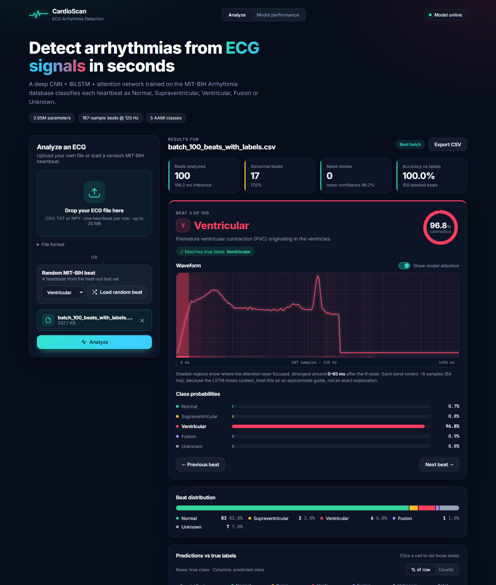
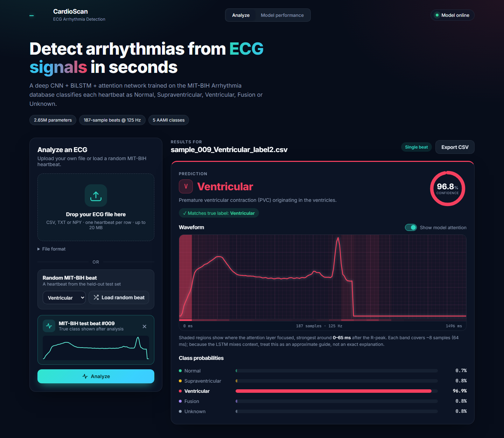
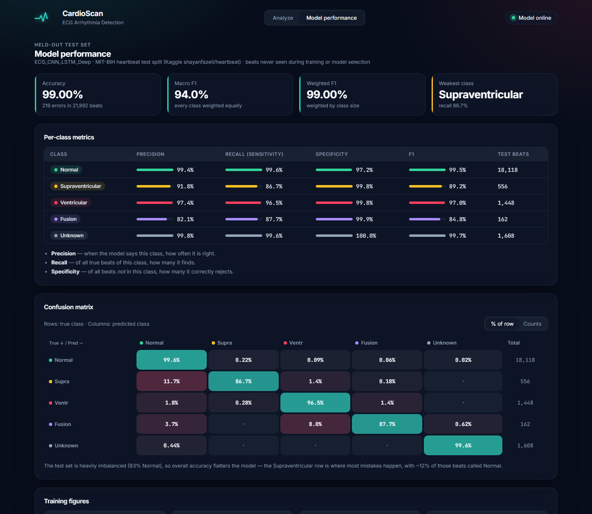

# ECG Arrhythmia Detection

A full-stack web application that classifies ECG heartbeats into the five AAMI arrhythmia classes with a deep
**CNN + BiLSTM + Attention** network trained on the MIT-BIH Arrhythmia Database.
Upload a single heartbeat or a batch of beats, or analyze a random beat from the MIT-BIH test set, and get
per-beat predictions, confidence scores and model-attention visualisations.

**Repository:** https://github.com/nikhilkumar905/ECG-Arrhythmia-Detection

**Live demo:** https://ecg-arrhythmia-detection-weld.vercel.app/

**Model weights (Hugging Face):** https://huggingface.co/nikhilkumar905/ECG-Arrhythmia-Detection

[](https://huggingface.co/nikhilkumar905/ECG-Arrhythmia-Detection)




## Classes

| Code | Class | Description |
|---|---|---|
| N | Normal | Normal beat, including bundle branch block and nodal escape beats |
| S | Supraventricular | Premature beat originating above the ventricles |
| V | Ventricular | Premature ventricular contraction (PVC) |
| F | Fusion | Fusion of a ventricular and a normal beat |
| Q | Unknown | Unclassifiable or paced beat |

## Features

- **Upload and analyze**: a single heartbeat or a batch of up to 5,000 beats (CSV / TXT / NPY, 187 samples per row)
- **Random MIT-BIH beat**: load a random heartbeat from the held-out test set, optionally of a chosen class,
  preview its waveform and analyze it
- **Per-beat results**: predicted class, confidence ring and probabilities for all five classes
- **Model attention**: highlights the parts of each beat the attention layer focused on
- **Needs-review flag**: marks beats with low confidence (< 70%) or two close top classes (margin < 20%)
- **Batch view**: class distribution, sortable list of all beats with filters, and ← / → keyboard navigation
- **Accuracy vs. labels**: confusion matrix and mismatch filter whenever true labels are provided
- **Model performance page**: test-set accuracy, F1, per-class precision / recall / specificity and training figures
- **CSV export** of all predictions; responsive layout with dark and light themes

| Single beat | Model performance |
|---|---|
|  |  |

## Model

| | |
|---|---|
| Architecture | 4 × Conv1d blocks → 2-layer BiLSTM (192 units/direction) → attention pooling → 4 FC layers |
| Parameters | 2.65 M |
| Input | One heartbeat: 187 samples at 125 Hz, scaled 0–1, standardised per time step |
| Training | AdamW, OneCycle LR, label smoothing, EMA weights, on-the-fly augmentation, mixed precision |
| Dataset | MIT-BIH Arrhythmia Database, Kaggle pre-segmented heartbeat split (21,892 test beats) |

**Test-set results**

| Accuracy | Macro F1 | Weighted F1 |
|---|---|---|
| 99.00% | 94.0% | 99.0% |

| Class | Precision | Recall | F1 |
|---|---|---|---|
| Normal | 99.4% | 99.6% | 99.5% |
| Supraventricular | 91.8% | 86.7% | 89.2% |
| Ventricular | 97.4% | 96.5% | 97.0% |
| Fusion | 82.1% | 87.7% | 84.8% |
| Unknown | 99.8% | 99.6% | 99.7% |

The training notebook is [`ecg(2).ipynb`](ecg(2).ipynb) (Google Colab, T4 GPU).

### Pretrained weights on Hugging Face

The trained model and scaler are published at
[nikhilkumar905/ECG-Arrhythmia-Detection](https://huggingface.co/nikhilkumar905/ECG-Arrhythmia-Detection)
(identical to the files in `models/`):

| File | Description |
|---|---|
| `best_model.pth` | PyTorch `state_dict` of `ECG_CNN_LSTM_Deep` (10.6 MB) |
| `scaler.pkl` | scikit-learn 1.6.1 `StandardScaler` fitted on the training beats |

Use them in your own code (run from `backend/`, after `pip install huggingface_hub`):

```python
import joblib, torch
from huggingface_hub import hf_hub_download
from model_definition import ECG_CNN_LSTM_Deep

repo = "nikhilkumar905/ECG-Arrhythmia-Detection"
model = ECG_CNN_LSTM_Deep(num_classes=5)
model.load_state_dict(torch.load(hf_hub_download(repo, "best_model.pth"), map_location="cpu"))
model.eval()
scaler = joblib.load(hf_hub_download(repo, "scaler.pkl"))

# beats: NumPy array of shape (N, 187)
x = torch.tensor(scaler.transform(beats), dtype=torch.float32).unsqueeze(1)
pred = model(x).argmax(1)   # 0=N, 1=S, 2=V, 3=F, 4=Q
```

## Tech Stack

- **Frontend:** React 19, Vite, custom SVG charts (no UI framework)
- **Backend:** FastAPI, PyTorch, scikit-learn
- **Training:** PyTorch on Google Colab
- **Hosting:** Vercel (frontend), Render (backend), Hugging Face Hub (model weights)

## Project Structure

```
├── backend/
│   ├── main.py               # FastAPI routes
│   ├── inference.py          # model loading, file parsing, beat segmentation
│   ├── model_definition.py   # ECG_CNN_LSTM_Deep architecture
│   ├── performance.py        # test-set metrics
│   └── requirements.txt
├── frontend/                 # React + Vite web app
├── models/                   # best_model.pth, scaler.pkl (also on Hugging Face)
├── examples/                 # beat batches (with and without labels) to try as uploads
├── test_samples_csv/         # MIT-BIH test beats used by the random-beat option
├── results/                  # training figures
├── docs/                     # screenshots
├── ecg(2).ipynb              # training notebook
└── start.bat                 # starts backend + frontend on Windows
```

## Getting Started

**Requirements:** Python 3.10–3.13 and Node.js 18+

```bash
git clone https://github.com/nikhilkumar905/ECG-Arrhythmia-Detection.git
cd ECG-Arrhythmia-Detection

# Backend (http://localhost:8001)
cd backend
python -m venv .venv
.venv\Scripts\activate            # macOS/Linux: source .venv/bin/activate
pip install -r requirements.txt
uvicorn main:app --port 8001

# Frontend (http://localhost:5173), in a second terminal
cd frontend
npm install
npm run dev
```

On Windows, after the first install you can simply run `start.bat`.
Interactive API docs are available at http://localhost:8001/docs.

## Input Formats

| Type | Format |
|---|---|
| Heartbeats | One beat per row, 187 values at 125 Hz scaled 0–1 (MIT-BIH heartbeat format); one row for a single beat, many rows for a batch. |
| Labels (optional) | A 188th column (0 = N, 1 = S, 2 = V, 3 = F, 4 = Q) is used as the true class to report accuracy. |

`.csv` and `.txt` files may be comma, semicolon, tab or space separated; header lines are skipped. `.npy` arrays work too.

## API

| Method | Endpoint | Description |
|---|---|---|
| GET | `/api/info` | Model and class information |
| POST | `/api/predict` | Classify an uploaded file of heartbeats (`file`) |
| GET | `/api/samples` | List the MIT-BIH test beats available for the random-beat option |
| GET | `/api/samples/{name}/download` | Raw values of one test beat (CSV) |
| POST | `/api/samples/{name}/predict` | Classify a test beat |
| GET | `/api/performance` | Test-set metrics |

## Limitations

- The Kaggle split separates heartbeats, not patients, so test scores are higher than for unseen patients.
- The model sees one lead and one beat at a time, without rhythm context.
- Supraventricular and Fusion beats are the hardest classes.

> **Disclaimer:** for research and educational use only. This is not a medical device.

## Acknowledgements

- MIT-BIH Arrhythmia Database: Moody & Mark, *IEEE Eng. Med. Biol.* 20(3), 2001, via
  [PhysioNet](https://physionet.org/content/mitdb/1.0.0/) (Goldberger et al., *Circulation* 101(23), 2000).
- Pre-segmented heartbeat dataset: Kachuee, Fazeli & Sarrafzadeh, *IEEE ICHI* 2018
  ([Kaggle](https://www.kaggle.com/datasets/shayanfazeli/heartbeat)).

## License

Released under the [MIT License](LICENSE).
